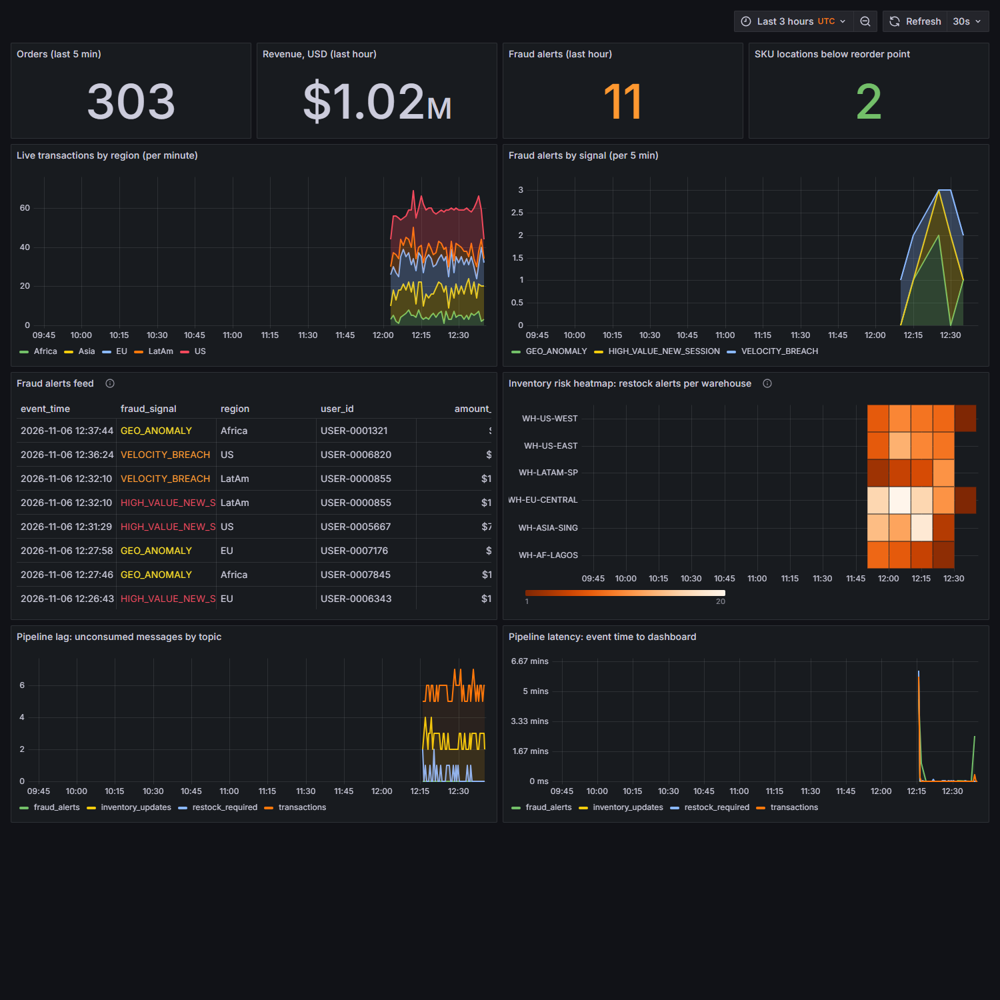
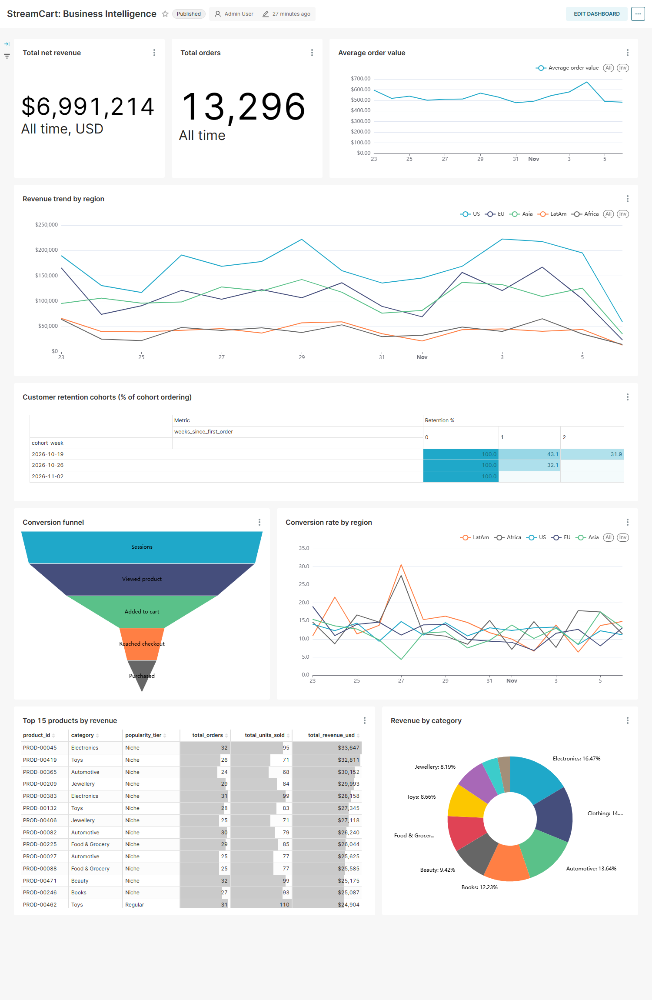
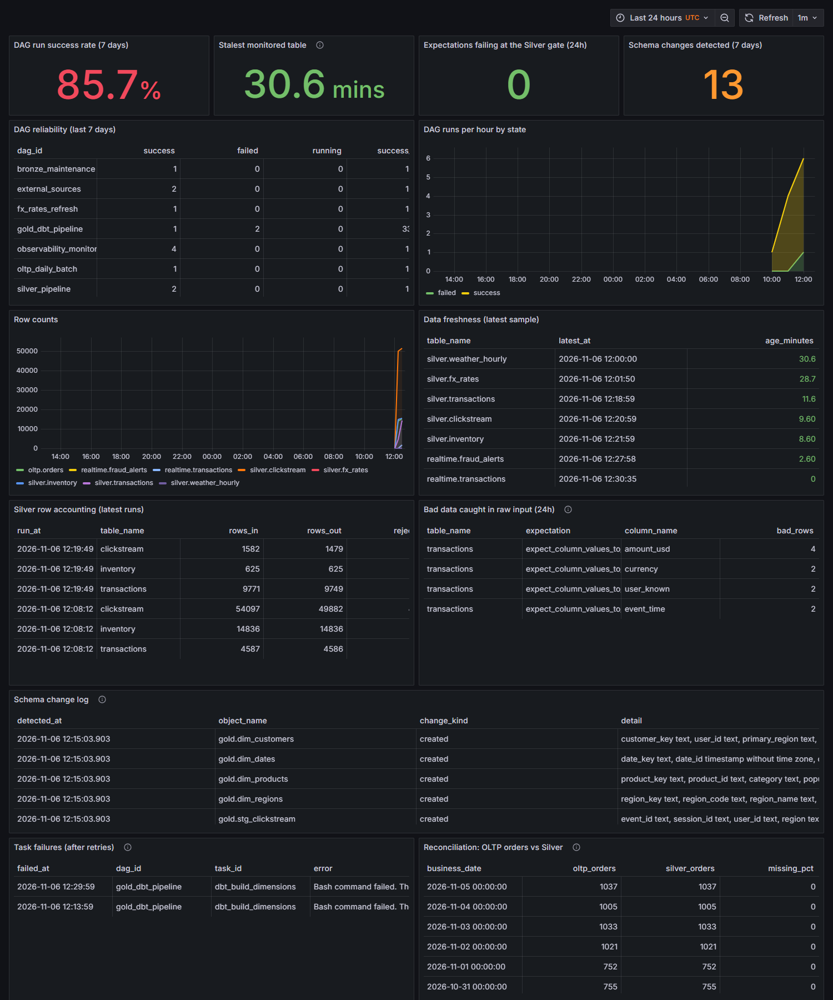

# StreamCart: Real-Time E-Commerce Intelligence Platform

[](https://github.com/Jerry-Khobby/StreamCart-Real-Time-E-Commerce-Intelligence-Platform/actions/workflows/ci.yml)

A data lakehouse for a simulated global e-commerce company. One event stream serves two needs: fraud and low-stock alerts within seconds, and validated historical analytics for the business.

**Stack:** Kafka, Schema Registry, ksqlDB, Spark Structured Streaming, Apache Iceberg, MinIO, Airflow, dbt, Great Expectations, PostgreSQL, Grafana, Superset, FastAPI, Docker Compose.

> **Project status:** all modules are implemented and tested end to end from a clean install. See [Verified results](#verified-results).

## The problem

The business has three pain points, all caused by siloed, slow data:

| Pain point | How StreamCart addresses it |
| --- | --- |
| Fraud is caught after the money has gone | ksqlDB evaluates fraud rules on every order as it arrives |
| Warehouses restock from yesterday's numbers | Low-stock events are published to a Kafka topic and shown live in Grafana |
| Teams maintain conflicting numbers | Marketing, finance and operations share one tested dimensional model |

## Architecture


**Speed path (seconds).** ksqlDB reads the live Kafka topics and writes `fraud_alerts` and `restock_required` back to Kafka. A small Python sink keeps Postgres serving tables current for Grafana and the REST API.

**Batch path (hourly and daily).** Spark streams Kafka into Bronze Iceberg tables on MinIO. An hourly Spark job validates and cleans that data into Silver, then publishes it to Postgres, where dbt builds the Gold star schema that Superset reads.

For a full walkthrough of the project, see the [project guide](docs/project-guide.md). Design decisions and data flows are in [docs/architecture.md](docs/architecture.md).

## Dashboards

**Real-time operations (Grafana):** live orders, fraud alerts, inventory risk and pipeline lag.



**Business intelligence (Superset):** revenue, retention cohorts, conversion funnel and top products.



**Pipeline observability (Grafana):** DAG reliability, row counts, freshness, data quality and schema changes.



All data shown is simulated.

## What's in each layer

### Data simulator

[producer/data_generator.py](producer/data_generator.py) produces more than 50,000 orders a day across five markets (US, EU, Asia, Africa, LatAm), with:

- Daily demand peaks, weekend dips and seasonal category weights
- Multi-currency pricing
- Pre-placed fraud: card testing bursts, account takeovers and geo anomalies
- Bot sessions, half of which spoof a browser user agent
- Stock levels that move with orders, restocks and write-offs
- About 1% deliberately corrupted events, so the quality checks have real faults to catch

### Ingestion

- Kafka topics `transactions`, `clickstream` and `inventory_updates`, with one partition per region
- [Avro contracts](schemas/avro) in Schema Registry with BACKWARD compatibility. Producers can't register new schemas themselves.
- Airflow DAGs for the daily OLTP pull, hourly FX rates and the weekly backfill

### Lakehouse

| Layer | Stored in | What happens there |
| --- | --- | --- |
| **Bronze** | Iceberg on MinIO | Raw events, partitioned by `region/year/month/day`, as Snappy Parquet. Kept 90 days, then archived to a cold-storage bucket. |
| **Silver** | Iceberg on MinIO, published to Postgres | Great Expectations gate, bot filtering, 30-minute session stitching, USD conversion at the rate in force at transaction time, and deduplication with `MERGE INTO`. |
| **Gold** | Postgres, built by dbt | 4 dimensions, 3 facts and 5 KPI aggregates, with dbt tests on every model. |

### Real-time

[streaming/ksql](streaming/ksql) defines the streaming logic:

| Signal | Rule |
| --- | --- |
| `HIGH_VALUE_NEW_SESSION` | Over $5,000 within 60 seconds of the session starting |
| `VELOCITY_BREACH` | More than 10 orders from one user in a rolling hour |
| `GEO_ANOMALY` | Order placed from outside the customer's home market |
| `restock_required` | Stock falls below the reorder point |

### Data quality and observability

- [Great Expectations suites](quality/expectations) run twice per table. The run on raw data measures how dirty the input is. The run on cleaned data is a gate: if it fails, nothing is written and the watermark doesn't move.
- Rows that fail are kept in a dead-letter table, so they can be inspected or replayed.
- dbt tests cover keys, accepted values, ranges and foreign key relationships. A failed test stops the next layer from building.
- A daily reconciliation compares source orders with Silver.
- The Grafana observability dashboard tracks DAG success rates, task failures, row counts, data freshness, quality results and schema changes.

[docs/best-practices.md](docs/best-practices.md) lists which data engineering practices are in place, which are partial, and which are deliberately left out.

### Dashboards as code

| Tool | Dashboard | Shows |
| --- | --- | --- |
| Grafana | Real-Time Operations | Live transactions by region, fraud alert feed, inventory risk heatmap, pipeline lag |
| Grafana | Pipeline Observability | DAG reliability, row counts, freshness, schema changes, quality results |
| Superset | Business Intelligence | Revenue trends, retention cohorts, conversion funnel, top products |

### REST API

| Endpoint | Purpose |
| --- | --- |
| `GET /inventory/stock` | Current stock, filterable by product and warehouse |
| `GET /inventory/low-stock` | Items below their reorder point, most urgent first |
| `GET /features/fraud/{user_id}` | Online features for a fraud model: order velocity, spend, regions and recent alerts |

Interactive API docs are at `/docs`.

## Getting started

You need Docker with Compose. The first build downloads several gigabytes.

```bash
git clone https://github.com/Jerry-Khobby/StreamCart-Real-Time-E-Commerce-Intelligence-Platform.git
cd StreamCart-Real-Time-E-Commerce-Intelligence-Platform
cp .env.example .env
docker compose up -d --build
```

### Hardware

The full stack is 22 services. It settles at about 4.6 GB of container memory, and peaks at about 6 GB while Spark batch jobs run. Allocate at least 8 GB to Docker, and keep Docker's disk on an SSD if you can. A cold start took 20 to 40 minutes with Docker's disk on a USB hard drive, and should be much quicker on an SSD.

### Running only part of it

Set `COMPOSE_PROFILES` in `.env` to run just what you need. Kafka, Schema Registry, Postgres and the simulator always run.

| Profile | Adds | Use it for |
| --- | --- | --- |
| `full` (default) | Everything | The whole platform |
| `realtime` | ksqlDB, serving sink, REST API, Grafana | Fraud and stock alerts |
| `batch` | MinIO, Spark, Bronze stream, Airflow, dbt | The lakehouse and Gold |
| `bi` | Superset | Business dashboards, once `batch` has built Gold |

Combine them with commas, such as `COMPOSE_PROFILES=realtime,batch`. Gold data stays in Postgres, so you can build it with `batch`, then stop that layer and browse it with `bi`.

### After it starts

A one-shot service seeds 14 days of history and the live generator begins streaming. Airflow starts its first Silver run automatically. Gold is built daily at 03:00 UTC. To build it straight away, wait for that Silver run to finish, then trigger `gold_dbt_pipeline` in Airflow.

| Service | URL | Login |
| --- | --- | --- |
| Airflow | <http://localhost:8080> | `admin` / `admin` |
| Grafana | <http://localhost:3000> | `admin` / `admin` |
| Superset | <http://localhost:8089> | `admin` / `admin` |
| REST API docs | <http://localhost:8000/docs> | none |
| MinIO console | <http://localhost:9001> | see `.env` |
| Spark master | <http://localhost:8081> | none |

If a port is already in use, change it in the host ports section of `.env`.

To run the tests and other day-to-day tasks, see [docs/operations.md](docs/operations.md).

## Verified results

Everything below was run against the live stack. The final code passed a clean install with empty volumes, and the fraud scores come from an earlier clean install with a longer live run.

| Check | Result |
| --- | --- |
| Clean install with `docker compose up -d --build` | All 22 services start, exit code 0 |
| Automated tests | 69 of 69 pass, and CI runs them on every push with lint, a dbt build on Postgres and image builds |
| dbt | 15 models build, and all 112 tests pass, layer by layer from empty tables |
| Silver on seeded history | 53,820 clickstream events in, 49,504 kept: bots and bad rows removed |
| Quality gate | A tightened rule blocked the write, and the retry recovered those rows with no loss or duplicates |
| Idempotency | After two full replays, row count equals distinct IDs in both Iceberg and Postgres, and in the dead-letter table |
| Reproducible replays | A row that arrived on time 30 days ago is still accepted, and one that arrived 30 days late stays rejected |
| Silver to Gold | 13,793 non-failed orders in Silver, 13,793 in `fct_orders` |
| Dead-letter table | Rejected rows are kept as JSON in `lake.silver.rejected_rows` |
| Read-only login | Grafana, Superset and the API can read, and writes are denied |
| Reconciliation | No orders missing from Silver across 7 complete seeded days |
| Failure feed | A real failed task was recorded for Grafana |
| Account takeover detection | 7 of 7 orders caught |
| Geo anomaly detection | 6 of 6 orders caught |
| Card testing detection | 10 of 10 users caught |
| False alarms | No alerts on users without injected fraud |
| Event to serving table latency | About 1 second |
| Schema contract | Registry refused an incompatible schema |
| 90-day retention | Old rows moved to the archive bucket and left Bronze |
| Time travel | An older Bronze snapshot returned its earlier row count |
| Recovery | The stack resumed unaided after the host slept and after a Kafka restart |

### Limits of these results

- **The data is simulated.** The fraud rules were written for the patterns the simulator injects, so those scores show the pipeline works, not how it would perform on real fraud.
- **The sample is small.** The fraud scores come from about 2,100 live orders.
- **It's a single-machine setup.** One Kafka broker, one Spark worker and one Postgres instance, so nothing is highly available.

## Repository layout

```text
api/                 FastAPI service for inventory and fraud features
batch/dags/          Airflow DAGs
batch/db/init/       Postgres schemas, applied on first start
batch/dbt/           dbt project for the Gold layer
consumer/            Spark jobs and the real-time serving sink
dashboards/          Grafana and Superset dashboards as code
docs/                Architecture and operations docs
producer/            Data simulator and schema registration
quality/             Great Expectations suites and runner
schemas/avro/        Kafka event contracts
streaming/ksql/      ksqlDB streams and tables
tests/               Automated tests
```
