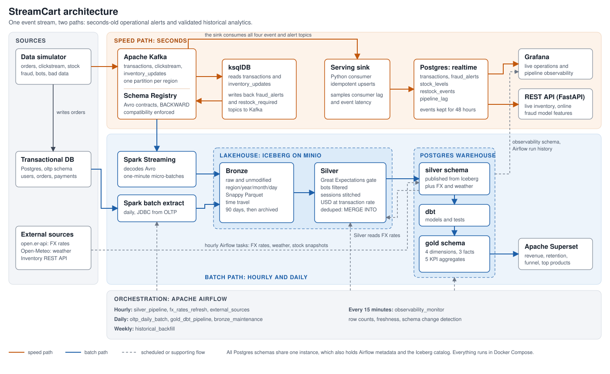

# Architecture

This document explains how data moves through StreamCart and why it's built this way. For how to run it, see [operations.md](operations.md).

## Data flow

### Speed path

1. The simulator publishes Avro events to Kafka, sending each to its region's partition.
2. ksqlDB filters out seed data and malformed orders, then evaluates the fraud and stock rules.
3. ksqlDB publishes matches to the `fraud_alerts` and `restock_required` topics.
4. `consumer/realtime_sink.py` upserts the live topics into the Postgres `realtime` schema, and commits Kafka offsets only after the database commit.
5. Grafana and the REST API read those tables.

### Batch path

1. `consumer/spark_streaming.py` writes each topic to a Bronze Iceberg table every minute.
2. `silver_pipeline` runs hourly and reads Bronze rows ingested since the last run.
3. Great Expectations profiles the raw rows, then the cleaning rules run.
4. Great Expectations validates the cleaned rows. A failure stops that table's write and fails the Airflow task.
5. Clean rows are merged into Silver Iceberg tables and published to the Postgres `silver` schema.
6. `gold_dbt_pipeline` runs daily, testing the sources, building staging, dimensions, facts and aggregates in order, then testing the output.
7. Superset reads the `gold` schema.

## Design decisions

### One image for Airflow and Spark

Airflow, the Spark cluster and the Spark drivers all run from one image. PySpark requires the driver and executors to share a Python minor version, and running the driver in an Airflow container with a separate Spark image makes that easy to break. Connector jars are baked in at build time, so jobs don't depend on resolving `--packages` when they start.

### Cores reserved for batch

A streaming application takes every core in a Spark standalone cluster unless it's capped. The batch job would then wait forever with `Initial job has not accepted any resources`. The Bronze job is capped at 1 of the worker's 3 cores, and an Airflow pool lets one batch job use the other 2 at a time.

### Layers for smaller machines

The full stack exhausted an 8 GB Docker VM at first: swap filled and load reached 119, with Docker's disk on a USB drive making it worse. Most of the waste was avoidable, so the fixes were cheaper healthchecks, one webserver worker, less DAG parsing and lower JVM heaps. It now settles at a load of about 5, and Compose profiles let you run one layer at a time.

### Iceberg's catalog lives in Postgres

Iceberg's Hadoop catalog needs an atomic rename, which S3-style storage doesn't provide. The JDBC catalog gets atomic commits from Postgres instead.

### Silver watermarks use ingestion time

Tracking the newest event time would skip any event that arrives late. Tracking when a row reached Bronze picks up late events, and the 7-day age rule then decides whether they're still acceptable.

### Bots are detected, not labelled

The simulator doesn't tell Silver which sessions are bots. Silver looks for bot user agents and for sessions averaging under 3 seconds between requests. The second rule is what catches the bots that spoof a browser.

### Session IDs are stable across runs

A stitched session ID is a hash of the user and the session's first event time. Silver includes two hours of earlier events when stitching, so a session spanning two hourly runs keeps one ID.

### FX rates are kept as history

`fx_rates_refresh` appends a new set of rates every hour instead of overwriting them, which lets Silver convert each order at the rate in force when it was placed. If the API is down the task fails and retries, and Silver keeps using the latest real rate. Events older than the first fetched rate use fixed fallback rates.

### Seed data is flagged

History is seeded with `is_backfill = true`. Without the flag, the 7-day age rule would reject the whole seed, and the fraud rules would raise alerts about events from two weeks ago.

### Fraud velocity is a separate query

The requirements describe all fraud signals in one `CASE` expression. ksqlDB can't join a stream to a windowed table, so `VELOCITY_BREACH` comes from a rolling one-hour table whose breaches are inserted into the same `fraud_alerts` topic. Because the window is hopping, one breach can emit several times. The sink's primary key on transaction and signal removes the repeats.

## Differences from the original requirements

| Requirement | What's built | Why |
| --- | --- | --- |
| Gold zone in the lakehouse | Gold in Postgres, built by dbt | The dbt project targets Postgres, and Superset and Grafana query it directly. Bronze and Silver are in Iceberg. |
| ksqlDB or Flink | ksqlDB only | The requirements allow either. |
| A database, API and event stream as independent sources | One simulator produces orders for both Kafka and the OLTP database | This keeps the sources consistent with each other, as in a real storefront. |
| `minio/minio` image | `bitnamilegacy/minio` | The official images can no longer be pulled from Docker Hub or Quay. The Bitnami image is frozen, so a long-lived deployment should plan a replacement. |

## Postgres schemas

One Postgres instance holds all of these, which keeps memory use practical on a single machine. A production deployment would separate them.

| Schema | Written by | Read by |
| --- | --- | --- |
| `oltp` | Simulator | Spark extract, Silver user check |
| `silver` | Silver job, Airflow tasks | dbt, Silver FX lookup |
| `gold` | dbt | Superset |
| `realtime` | Serving sink | Grafana, REST API |
| `observability` | Silver job, `observability_monitor` | Grafana |
| `public` | Airflow, Iceberg catalog | Grafana (DAG run history), Spark |

## Airflow DAGs

| DAG | Schedule (UTC) | Purpose |
| --- | --- | --- |
| `silver_pipeline` | Hourly | Bronze to Silver |
| `fx_rates_refresh` | Hourly | Append FX rates |
| `external_sources` | Hourly at :05 | Weather, and stock from the inventory API |
| `observability_monitor` | Every 15 minutes | Row counts, freshness, schema changes |
| `oltp_daily_batch` | Daily 00:30 | Extract orders, payments and users to Bronze |
| `gold_dbt_pipeline` | Daily 03:00 | Build and test Gold |
| `bronze_maintenance` | Daily 04:00 | Archive after 90 days, compact, expire snapshots |
| `historical_backfill` | Sundays 02:00 (paused on install) | Replay 7 days through Silver, then rebuild Gold |
